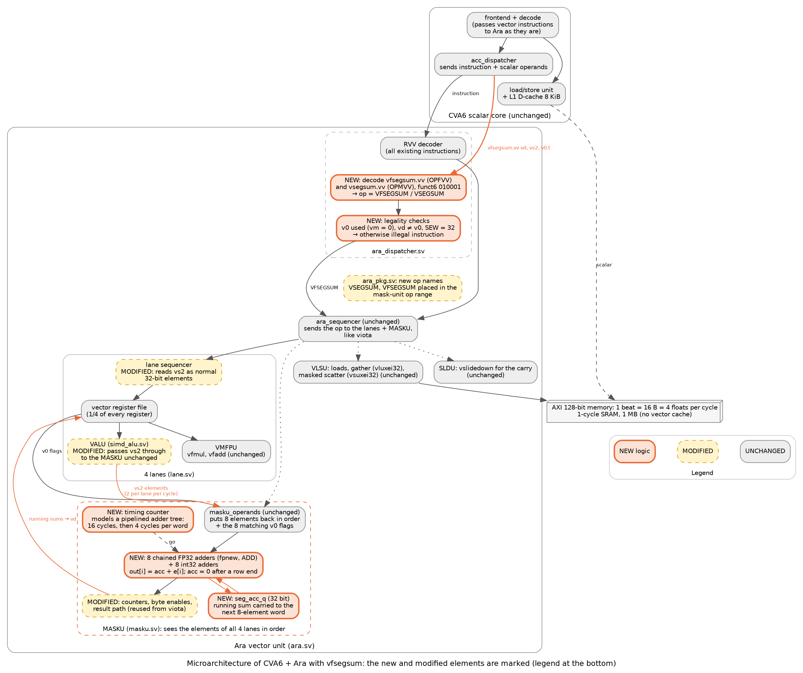
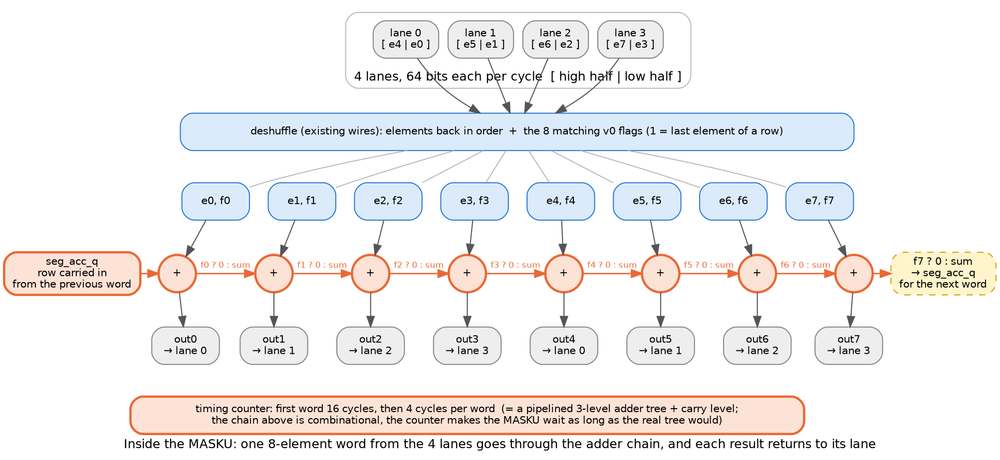
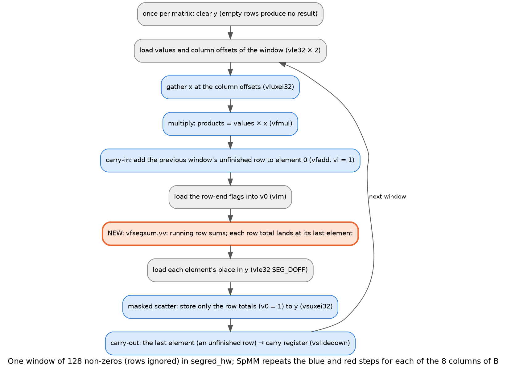
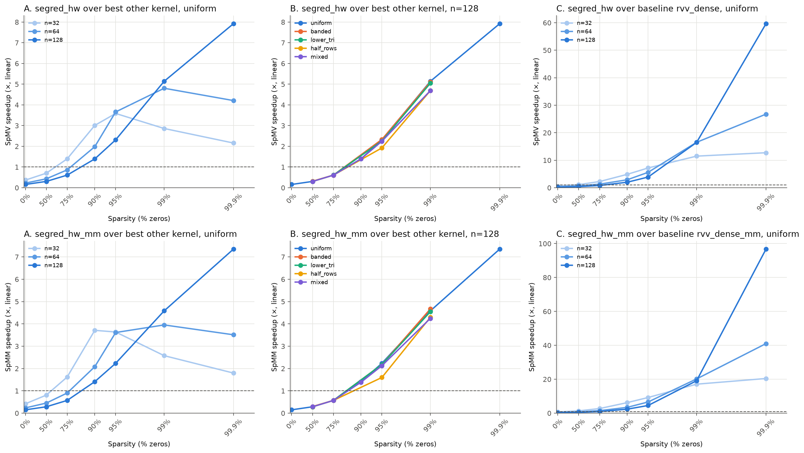

# Sparse-aware vector execution on Ara: the `vfsegsum` instruction

This document explains the idea, the new instruction, how it is built inside Ara, and how the sparse kernels use it. A shorter outline of where the idea started is in [`IDEA.md`](IDEA.md); the code, tests and run instructions are in [`sw/`](sw/README.md).

## 1. The problem

In CSR SpMV (y = A·x), a vector unit handles **one row at a time**. It multiplies the row's non-zeros by the matching elements of x, then **reduces** them (adds them up) into y[row].

On Ara, a reduction has a large fixed cost: about 30 cycles even for one element, plus the time for the scalar core to read the result. This cost is paid **once per row**, however short the row is. At high sparsity most rows hold only a few non-zeros, so most of the time goes into per-row overhead instead of useful work.

## 2. The idea: segmented reduction over windows of non-zeros

Stop working row by row:

1. Put all non-zeros of the matrix into one flat list and process it in **windows** of up to VLMAX elements (one full vector register, 128 × FP32 here), ignoring row boundaries.
2. Keep the rows apart with a small piece of **sparse metadata**: a bitmap that marks the **last non-zero of each row** with a 1 (the *tail flag*).
3. Inside each window:
   1. multiply every non-zero by its element of x (gather + multiply);
   2. compute a **running sum that restarts after every tail flag**, so each row's total lands at that row's last element;
   3. store only the elements with a tail flag, each to its row of y (masked scatter).
4. A row cut by the end of a window passes its partial sum (the **carry**) to the next window.

```
A = [5 0 0 2]      non-zeros, flat:   5   2 | 1   3   4 | 6   7      (row 1 is empty)
    [0 0 0 0]      products (val·x):  5   8 | 1   6  16 | 18  28     x = [1, 2, 3, 4]
    [1 3 0 4]      tail flags:        0   1 | 0   0   1 | 0   1
    [0 0 6 7]      running sums:      5  13 | 1   7  23 | 18  46
                   stored to y:          y0=13      y2=23      y3=46   (y1 stays 0)
```

The per-row reductions disappear. One window handles up to 128 non-zeros, however many rows it contains.

Standard RVV has no "running sum that restarts at flags" instruction. Building it from existing instructions takes log₂(VLMAX) rounds of slide + masked add, so it becomes one new instruction.

## 3. The new instruction

```
vfsegsum.vv vd, vs2, v0.t      # FP32
vsegsum.vv  vd, vs2, v0.t      # int32 (used for bring-up testing)

acc = 0
for i in 0 .. vl-1:
    acc   = acc + vs2[i]
    vd[i] = acc
    if v0[i] == 1: acc = 0     # this element ends a row
```

- `vs2` = products, `v0` = tail flags, `vd` = running sums. Every position gets its running sum, so each row total sits at its tail, and a masked store with `v0` writes only the totals.
- **Encoding:** an unused slot in the RVV arithmetic space, funct6 = `010001` (OPFVV for float, OPMVV for integer). Example: `vfsegsum.vv v10, v9, v0.t` = `0x44901557`.
- **Legality:** the instruction traps as illegal unless it is masked (v0 holds the flags), vd ≠ v0, and SEW = 32.

Example: `vs2 = [2 3 4 5 6 1 7 8]`, `v0 = [0 0 1 1 0 1 0 0]` gives `vd = [2 5 9 5 6 7 7 15]`. The row totals 9, 5 and 7 sit where v0 = 1. The final 15 belongs to an unfinished row and becomes the carry.

## 4. Hardware: where it lives and why



Ara splits every vector across its lanes: element *i* lives in lane *i mod 4*. A lane only sees its own elements, but a running sum needs **all elements in order**. The one block that already sees every lane's elements in order is the **mask unit (MASKU)**, which runs `viota` (a running count). So `vfsegsum` is built there, reusing `viota`'s lane → MASKU → lane path. No new wires between blocks were needed.

| Block | File (`hardware/`) | Change |
|---|---|---|
| Op list | `include/ara_pkg.sv` | new ops `VSEGSUM`, `VFSEGSUM`, placed in the MASKU's op range so the sequencer routes them like `viota` |
| Dispatcher | `src/ara_dispatcher.sv` | decodes the two encodings and checks legality |
| Lane sequencer | `src/lane/lane_sequencer.sv` | reads vs2 as normal 32-bit elements |
| Lane ALU | `src/lane/simd_alu.sv` | passes vs2 through to the MASKU unchanged |
| MASKU | `src/masku/masku.sv` | 8 chained FP32 adders (fpnew, ADD mode) and 8 int32 adders, the running-sum register `seg_acc_q`, a timing counter, and result counters reused from `viota` |

CVA6, the load/store unit, the slide unit, the lane FPUs and the register file are unchanged.

### Inside the MASKU



Each lane delivers 2 × 32-bit elements per cycle, so 4 lanes deliver one **8-element word**. The MASKU puts the word back in order with the matching 8 tail flags and feeds an adder chain:

```
seg_acc_q (row carried in from the previous word)
   |
e0 -> [+] -> out0      next adder starts from (f0 ? 0 : out0)
e1 -> [+] -> out1      next adder starts from (f1 ? 0 : out1)
 ...
e7 -> [+] -> out7  ->  seg_acc_d = (f7 ? 0 : out7) -> flip-flop -> seg_acc_q
```

- Each output goes back to the lane its element came from. A vector of 128 elements arrives as 16 words.
- The chain adds in exactly the order of the C loop, so the FP32 results are **bit-for-bit equal** to a scalar reference.

**Realistic timing.** Eight chained FP adds don't fit in one clock cycle on a real chip, and Verilator only counts cycles, so it can't catch this. A **timing counter** makes the MASKU take as long as a realistic **pipelined adder tree** would. That tree computes the same sums in 3 levels (each element adds the partial sum 1, then 2, then 4 places to its left until it reaches its row start), plus 1 carry level, using 25 FP32 adders. Each level is one 4-cycle FP add, so:
- the **first word takes 16 cycles**;
- **each later word takes 4 cycles** (it only waits for the previous word's carry).

All reported results include this delay.

## 5. How the kernels use it



**SpMV (`segred_hw`)**, per window of up to 128 non-zeros:
1. load values and column offsets;
2. gather x (`vluxei32`);
3. multiply (`vfmul`);
4. add the carry into element 0 (`vfadd`, vl = 1);
5. load tail flags into v0 (`vlm`);
6. **`vfsegsum`**;
7. load row offsets into y;
8. masked scatter to y (`vsuxei32 … v0.t`);
9. slide the last element into the carry register (`vslidedown`).

That is about 14 vector instructions per 128 non-zeros, instead of about 5–6 instructions plus one reduction **per row**.

**SpMM (`segred_hw_mm`)**, C = A·B with B dense (8 columns): the window's A data (values, offsets, flags, row offsets) is loaded once. Then gather / multiply / carry / `vfsegsum` / scatter run for each column of B, each with its own carry register.

The metadata (tail-flag bitmap, row-offset table, per-window info) is built once, offline, from the CSR matrix.

## 6. Results

Full tables: [`sw/results/summary.md`](sw/results/summary.md). Setup: Ara RTL in Verilator (4 lanes, VLEN = 4096, CVA6, ideal 1-cycle memory). 43 synthetic matrices (uniform n = 32/64/128, banded, lower-triangular, half-empty-rows, mixed density; 0–99.9% sparsity), 2 workloads, 5 kernels each: **430 kernel runs, all correct**. "Best other" is the fastest of scalar CSR, a tuned dense RVV kernel and a vector CSR kernel, all running on unmodified Ara. Averages are geometric means.

| Sparsity | SpMV vs best other | SpMM vs best other | SpMV vs baseline RVV | SpMM vs baseline RVV |
|---|---|---|---|---|
| 0–50% | 0.33× | 0.33× | 0.47× | 0.54× |
| 75–99% | **2.03×** | **1.94×** | 3.92× | 4.68× |
| 99.9% | **4.16×** (up to 7.93×) | **3.59×** (up to 7.36×) | 27.3× | 43.3× |



- Sparse execution with `vfsegsum` beats dense execution from **75–90% sparsity** at n = 128, and is the fastest kernel above that on every matrix.
- It is **slower at low sparsity**. Rows are long there, so the per-row saving is small, and every element still pays for a gather and a scatter. Its cost is about 3.3 cycles per row plus 5.4 per non-zero, against about 70 per row plus 2.4 per non-zero for vector CSR, so it wins when rows have fewer than about 20 non-zeros.

## 7. Limitations and future work

- The pipelined adder tree is a **timing model**. The RTL implements a combinational chain. Next steps: build the tree in RTL and synthesize it for area and timing, or try a smaller 2- or 4-wide tree.
- Memory is an ideal 1-cycle SRAM, and the matrices are synthetic with n ≤ 128.
- The encoding uses an unused RVV slot, not a ratified extension.
- The carry-in could come from `vs1[0]` inside the instruction, saving one instruction per window.
